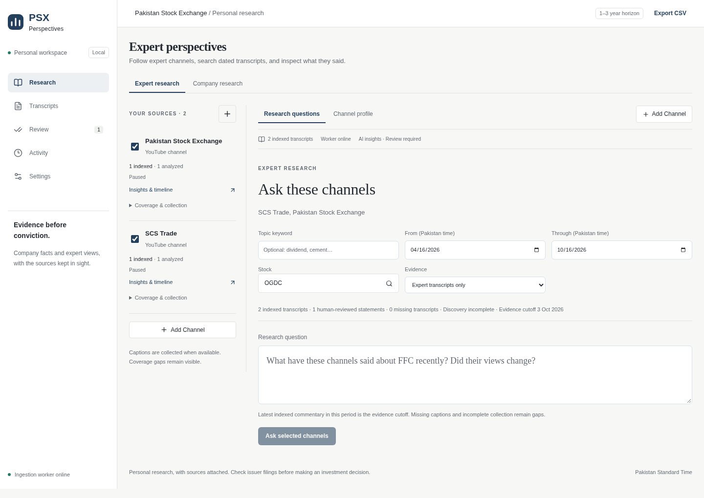

# PSX Perspectives

[Quick start](#quick-start) · [Contributing](CONTRIBUTING.md) · [Security](SECURITY.md) · [MIT license](LICENSE)

A local research workspace for exploring what YouTube channels say about Pakistan Stock Exchange companies. Ask questions in English, Urdu, or mixed language, compare dated perspectives, and inspect the original transcript behind each citation.

PSX Perspectives keeps expert commentary separate from company fundamentals. It helps you inspect evidence; it does not place trades, predict returns, or certify investment recommendations.



The preview uses synthetic test data. Collected transcripts and personal research are not included in this repository.

## What you can do

- Follow a channel after confirming its identity and collect up to six calendar months of public video metadata and available captions.
- Read channel timelines, cited summaries, and stock/topic statements. Correct or reject automatic statements against the original transcript.
- Ask across selected channels, dates, and stocks. Open saved evidence beside the answer, with video timestamps when the source supplies them.
- Import TXT, SRT, or VTT transcript text when captions are unavailable.
- Translate saved transcripts and source passages into Urdu or English alongside the original, with reusable saved results.
- Use Company research for a ten-company fundamentals dashboard, watchlists, four-company comparisons, and dated official PSX observations.
- Edit bilingual stock aliases, inspect collection jobs, and export company research as CSV or Markdown.

## Quick start

Requires **Node.js 22.13+** and npm. Linux may need C++ build tools if a compatible `better-sqlite3` binary is unavailable.

```sh
git clone https://github.com/GulShair6/psx-perspectives.git
cd psx-perspectives
npm ci
cp .env.example .env
npm run dev
```

Open [PSX Perspectives locally](http://127.0.0.1:3000). The launcher starts the website and a separate ingestion worker. Stop both with Ctrl+C.

The first run creates a SQLite database and seeds the company/source catalog. It does not ship someone else's research corpus. Import transcripts or configure collection to build your own evidence library. Without provider keys you can inspect saved evidence and use lexical search; cloud synthesis and channel-name discovery require their respective keys.

For a production build on your own computer:

```sh
npm run build
npm start
```

**Run on localhost only.** This app has no user authentication and is not designed as a public hosted service. Sharing the source repository is supported; exposing your running research workspace to the internet is not.

## Configuration

Set keys in `.env`, never in source code. On Unix, use `chmod 600 .env`. Restart the app after editing configuration.

- `OLLAMA_API_KEY`: enables expert summaries, extraction, explicit translation fallback, and answers through Ollama Cloud (`gemma4:31b`). Expert research uses this provider only.
- `YOUTUBE_DATA_API_KEY`: enables channel search and paginated uploads discovery. Enable YouTube Data API v3 and restrict the server key to that API. Browser-referrer restrictions are unsuitable for this server-side integration.
- `OPENAI_API_KEY`: optional provider for company research when Ollama is absent; it does not enable expert cloud research.
- `PSX_DB_PATH`: optional database path; defaults to `data/research.sqlite`.

Both processes load `.env`, then `.env.local`; inherited environment variables take precedence. Keep development dependencies installed in production because the worker uses `tsx`.

Selected questions and evidence are sent to the configured cloud provider. Calls have no application spending cap; provider account limits still apply. Credentials remain server-side. Environment files, collected data, backups, and browser artifacts are ignored by Git.

## A first research session

1. In **Expert research**, choose **Add Channel**, search a name, `@handle`, or channel URL, inspect the identity, then confirm it.
2. Inspect **Coverage & collection** for discovery/indexing progress, missing captions, errors, pause/resume, and history synchronization. Enabled channels check every six hours while the worker runs.
3. Open **Insights & timeline** to browse statements or videos. Cited summaries and transcript previews preserve original text and supplied times. Automatic claims can be reviewed and corrected independently of the immutable extraction payload.
4. Select channels, dates, and optionally a stock. Ask a question such as “How did these channels' views on OGDC change during the selected period?”
5. Open each citation and check its context. An answer's cutoff is the latest indexed commentary in the selected period, not a live market view. Missing or invalid cloud responses leave retrieved evidence available with an explicit gap.

For manual imports, switch to **Company research → Transcripts**. Paste the transcript with its video URL, title, speaker, publication date, and language. Plain text receives video citations without fabricated timestamps.

Company observations can be included in expert answers through the combined evidence setting. Company prices, historical channel targets, and opinions remain distinct. Company collection can be queued from the interface or with `npm run refresh`.

### Read a translation

Open a transcript, a transcript citation, or **Review / correct statement**, then choose **Translate to Urdu** or **Translate to English**. The buttons use saved text and local IndicTrans2 models. No YouTube or cloud translation is requested automatically. The transcript reader prepares its current page first; **Prepare full transcript** explicitly prepares the rest. Citation and review readers translate the relevant source chunks, including surrounding context. Results stay beside the original on desktop and underneath on mobile, with Urdu right-to-left text and source timestamp links. Closing a reader lets queued work continue. Retry resumes only missing blocks.

Local output is **provisional** until separately compared with audio. Urdu becomes the preferred reading view only after thirty audio-checked passages across at least three channels pass names, units, negation and meaning checks. Numeric tokens must also retain exactly their original notation. These structural checks cannot certify linguistic or financial accuracy. Roman Urdu and Punjabi Shahmukhi are unsupported locally; mixed Indic scripts need correction or explicit fallback. Script detection tolerates Hindi-labelled Urdu/Hindustani; language metadata is a hint, not an absolute restriction.

**Try YouTube captions** is optional and may download a complete target-language track, even for one passage. Creator captions take precedence over automatic captions and auto-translation. YouTube cues keep their own timestamps and are shown only where they overlap the displayed original. Untimed passages cannot be aligned. Number differences are warned about without altering the YouTube text. Blocking responses start a shared persisted twenty-four-hour cooldown across caption ingestion and language requests. Saved text remains readable throughout.

**Use Ollama Cloud** is an explicit fallback after a local or YouTube failure. It reuses saved Ollama results before spending quota for missing text. Only this choice sends saved text, title and language hint for cloud translation. Source labels distinguish local output, reused Ollama output, creator captions, automatic captions and YouTube auto-translation. All remain separate from independent accuracy reviews. Confirm the original caption or audio before submitting a review reference.

### Install and evaluate local models

Use Python 3.11 and at least **8 GiB free disk** for setup headroom. The three official [IndicTrans2 distilled models](https://github.com/AI4Bharat/IndicTrans2) require you to accept their Hugging Face access conditions yourself. Configure `HF_TOKEN` locally for the download; never paste it in chat or commit it. Model revisions and direct runtime dependencies are pinned under `local_translation/`; the Python environment and weights stay in ignored `data/local-translation/`.

The optional model stack remains experimental. Its remaining PyTorch and Transformers advisories require review before release; the npm dependency audit does not cover them. See [local-runtime security status](docs/local-runtime-security.md). After a Python dependency update, rerun setup and the model quality/capacity trials before treating that environment as validated.

```sh
python3.11 local_translation/setup.py
npm start
npx tsx scripts/local-translation-check.ts status
```

The launcher starts the installed runtime using a private Unix socket. It keeps one CPU model loaded, runs inference sequentially with two CPU threads, disables Hugging Face networking/telemetry and outgoing socket connections, and never truncates tokenized input. Long chunks are split at sentence/word boundaries, with bounded splitting when necessary. Missing models or a stopped runtime produce a readable status; cached results still work. Setup downloads are online; inference is offline. Live dependency installation and offline model execution remain unverified until model access and disk space are supplied.

Reading jobs take priority. English preparation for newly saved videos follows, without cloud reanalysis. Archive preparation for enabled channels runs only after independent English quality review, the twenty-question retrieval evaluation (at least eighteen passes), and a same-machine capacity report. Failed background blocks need explicit retry. Archive processing stays gated while any report is missing. The capacity gate requires projected English processing for ten typical videos within eight hours, peak runtime memory under 4 GiB and app responses under one second during inference; these are conservative initial thresholds to verify on this machine.

```sh
npx tsx scripts/local-translation-check.ts sample
npx tsx scripts/local-translation-check.ts benchmark
# Human reviews audio and fills reviews in data/local-translation/trial.json.
npx tsx scripts/local-translation-check.ts import-reviews
npx tsx scripts/local-translation-check.ts retrieval
```

The sample contains thirty real, timestamp-linked passages across channels, prioritizing figures, negation and conditions. A human must confirm genuine Hindi versus Hindi-labelled Urdu, code mixing and names against audio. Each `reviews.ur` / `reviews.en` entry needs `reviewer`, `audioChecked: true`, a `sourceKind` (`hindustani`, `hindi`, `english` or `punjabi`), a `cases` list (`code-mixing`, `company-names`, `financial-figures`, `negation`, `conditional` where present), and boolean `names`, `units`, `negation`, `meaning` fields; do not fill these automatically. Benchmarking saves cold/warm timings, peak memory and projected daily throughput, along with outputs for human review. The retrieval command reuses `tests/expert-research-questions.json`, makes no synthesis calls, and writes original citations to `retrieval-trial.json`; independently label all twenty entries and save the completed report as `retrieval-reviews.json` alongside it. Reports are tied to the model/processing version; translation reviews are also tied to source hashes.

English derived text has a separate SQLite search index linked to original chunks. It never creates independent expert evidence or changes source text, citation timing, extraction checkpoints or review scores. Supported Urdu questions are translated locally and cached; unavailable local translation falls back to literal text and stock aliases. The standard question path uses local ranking, **at most one cloud synthesis request**, and no cloud planner, reranker or answer repair. A rejected answer returns saved evidence. Validated answers are cached against question, filters and evidence/source/review/translation versions. Results show whether a saved answer was reused and how many cloud requests were made.

TXT/SRT/VTT imports remain the caption recovery path. Audio acquisition/transcription, training, translation editing, unofficial free translation websites and additional providers are outside this version.

## How it works

The Next.js/React interface talks to a localhost-only API. SQLite stores original caption segments, searchable chunks, company snapshots, review decisions, and resumable job checkpoints. A sequential worker discovers videos, retrieves available captions, indexes transcripts, and queues cloud analysis.

Retrieval scopes SQLite full-text search and stock/topic relationships to your filters before deterministic ranking. Local English translations extend search when available. Selected original evidence feeds at most one cloud synthesis request; there is no cloud planner, reranker or correction request. Invalid synthesis returns saved evidence and an explanation. Urdu reading preparation does not invalidate an unchanged saved answer.

This is lexical and structured retrieval, without embeddings, a vector database, or GraphRAG. The broader stock-symbol catalog is separate from the ten-company fundamentals dashboard.

The source is organized into `app/` (interface and API), `lib/` (collection, retrieval, validation, and storage), `migrations/` (transactional schema updates), `scripts/` (launch/maintenance/browser checks), and `tests/` (isolated regressions and acceptance questions).

## Limits and verification status

- Captions may be missing, blocked, or inaccurate. Automatic tracks can mislabel spoken Urdu. A YouTube Data API key enables metadata discovery, not universal caption download. Manual imports are the supported fallback; no audio is downloaded or transcribed.
- Collection coverage is explicit. Recent-feed fallback cannot establish complete history; bounded retrieval cannot establish exhaustive agreement between channels. Historical imports cannot recover timestamps or provenance that were never saved.
- AI output is labeled as automatic and needs human review. Independent real-corpus evaluation is still pending: the 20-question relevance checklist in `tests/expert-research-questions.json` (at least 18 must retrieve independently labeled required evidence, including chronological and cross-channel context, or correctly identify its absence), and at least 30 independently reviewed real passages/chunks with 90% stock/stance accuracy. Fixture success does not certify model quality. Verified company consensus remains gated by independent review.
- Public source layouts, captions, provider availability, and quotas can change. Source failures remain visible. Missing company metrics are not synthesized; 1Y price returns exclude payouts. Dividend endpoints may be unavailable.
- Shariah classification requires a dated human-reviewed official source. Classifications older than 180 days are excluded from the compliant filter; this convention is not a certification.
- Seeded InvestKaar identity remains unresolved until a valid channel identity is supplied. Channel-name search and full uploads discovery require a YouTube key. Discovery completeness and transcript availability are reported separately.

## Tests

```sh
npm test
npm run typecheck
python3 -m unittest discover -s local_translation -p 'test_*.py'
npm run build
npx playwright install chromium
npm run test:browser
```

The automated suites cover parsers, calendar boundaries, resumable collection, source identity, scoped retrieval, extraction validation, review preservation, provider failures, credential redaction, and request validation. Browser checks launch an isolated production server/worker and exercise research, evidence, imports, reviews, watchlists, comparison, settings, exports, connection recovery, keyboard interactions, accessibility, and responsive layouts. Synthetic browser fixtures are labeled and never added to your database.

Browser checks require a completed build. Screenshots are saved under ignored `data/browser-artifacts/`. Tests validate implementation behavior; they do not guarantee live source availability or financial/model accuracy.

## Evidence repairs and runtime recovery

Preview saved-record repairs with `npm run repair -- --preview`. The preview opens SQLite read-only and writes a private report under `data/repairs/`; it does not run migrations or contact a provider. Stop the app and worker, then run `npm run repair -- --apply` to create a consistent SQLite backup, save the proposed changes and apply them transactionally. Use `--report /absolute/path/report.json` to choose the report location. Completed reports and unrelated files cannot be overwritten; choose a new report filename for each apply. Repeating the command makes no further record changes.

Repairs quarantine invalid automatic statements and pending legacy opinions, retaining their payloads and reasons. Human-reviewed or rejected records and independent labels remain unchanged; conflicts and unresolved source mappings appear in the report. Review counts combine both review systems by original caption segments, counting overlapping source spans once and taking their lowest correctness result. Ambiguous source mappings do not count toward the accuracy gate.

Corrupted imports can be rebuilt only when a retained import job contains the exact original file text and the video has no human decisions, including translation reviews. Replaced records are archived in the report and backup. Missing raw input requires the original TXT/SRT/VTT file; the repair never guesses missing words or figures. Repaired sources receive a new hash and a failed analysis marker requiring explicit resume; repair itself makes no cloud requests or automatic reanalysis jobs.

Processing version `local-2` isolates token-length probes from entity restoration. Earlier local translations and reviews remain stored but cannot satisfy current reading/search or quality gates. The English derived index is cleared by the additive upgrade and filled only by current validated results. Model revisions are unchanged. Live model inference, financial-language accuracy and throughput remain pending; Urdu stays provisional and archive preparation remains gated.

A restarting worker waits up to 35 seconds for the previous lease to expire. A healthy local runtime publishes a private readiness heartbeat even while inference is busy. A dead process or expired heartbeat is unavailable; saved translations remain readable and no cloud fallback happens automatically. Restart the app to restart its optional local runtime.

`npm run proof` is an optional live PSX/feed/caption smoke check. `npm run refresh` retrieves official observations and updates your database. Both depend on external services and are separate from deterministic tests.

Before live release sign-off:

1. Configure the YouTube key locally and restart. Confirm a searched channel, synchronize its history, and inspect coverage, saved transcripts, and pause/resume behavior. Record missing captions and discovery errors.
2. Use [the 20-question checklist](tests/expert-research-questions.json). Fix the channel/date filters for each question, independently identify the required source passages before asking, and check the top-ten retrieved evidence, answer citations, dates, and timestamps. Record each result; at least 18 of 20 must meet the evidence requirement or correctly report its absence.
3. Open a channel's timeline and choose **Review / correct statement**. Check the original passage, correct the stock and stance, then select **Use corrected stock and stance as my independent accuracy reference** before saving. Evaluate at least 30 distinct real source passages/chunks; stock/stance accuracy must reach 90%. Keep these private review records outside the public repository.

## Backup and restore

```sh
npm run backup
```

The backup uses SQLite's online backup API, including committed WAL content, and saves a dated file under `data/backups/`. If you use a custom database path, run the command with the same `PSX_DB_PATH` environment variable. The standalone maintenance scripts do not automatically load `.env`.

Take a backup before upgrading; migrations run automatically on database initialization. Restarting the worker resumes collection and analysis.

To restore, stop the website and worker, copy the backup to a clean database location, set `PSX_DB_PATH` to it, and restart. Do not replace a running database or reuse stale WAL/SHM files beside a replacement.

## Contributing and licensing

See [CONTRIBUTING.md](CONTRIBUTING.md) for development setup, checks, and review expectations. Pull requests run formatting, strict TypeScript checks, isolated Node/Python tests, a production build, npm dependency auditing, and browser/accessibility checks without provider credentials. Weekly Dependabot updates cover npm dependencies, optional Python requirements and GitHub Actions.

Maintainers can follow [RELEASING.md](RELEASING.md) for verification, backups, GitHub protections, and publication steps.

Bug reports and focused pull requests are welcome. Include reproduction steps and relevant checks; use disposable data for tests. Never attach credentials, personal database files, or collected transcripts to an issue or pull request. For a security concern, use the repository's private vulnerability-reporting option if available; do not publish credentials or an exploit containing private data.

The code is [MIT licensed](LICENSE). PSX, YouTube, and channel content have their own rights and access terms; the code license does not grant permission to redistribute that content. Share the source, not your private research database or someone else's transcripts.
